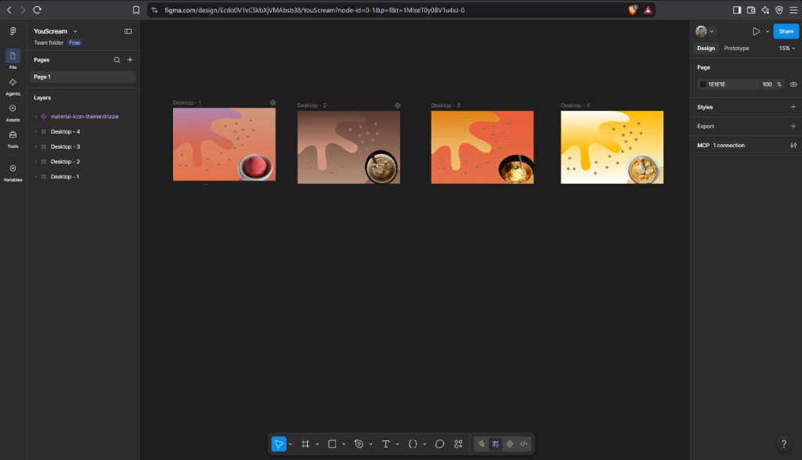

# Lab 8 — UI/UX Prototyping with Figma

**Rizwan Shariff S M** · **4NI25CS163**  
1BCS303 — Collaborative Development and DevOps  
Department of Computer Science and Engineering, NIE Mysuru

---

## Overview

The final CDD experiment looks at the design side of collaborative work. Two
Figma files were built to practise frames, reusable components, layer grouping
and clickable prototype flows.

## Prototype 1 — YouScream

YouScream is a four-screen desktop concept for a dessert brand. Each screen uses
a different colour direction while keeping the same layout, so the set reads as
one product rather than four unrelated designs.

The file includes:

- four desktop frames (`Desktop - 1` to `Desktop - 4`, 1440 × 1024)
- gradient backgrounds and a vector drizzle shape
- repeated doughnut icons used as decorative elements
- a shared dessert image and grouped layer structure
- prototype links connecting the four screens into one flow

## Prototype 2 — F1_PAGE

F1_PAGE is a fourteen-screen motorsport portal. The frames cover the driver
line-up, individual driver pages and the supporting detail screens, all joined
into a single navigation flow.

## Design boards

### YouScream — multi-screen canvas

### YouScream — prototype flow

### YouScream — components and transformations

### YouScream — landing screen with vector drizzle

### F1_PAGE — fourteen-screen flow

## What I practised

- building frames and arranging them on a shared page
- reusing visual elements instead of redrawing them
- keeping layers and groups readable
- connecting screens in the Prototype tab
- treating a design file as a shared reference for a team
