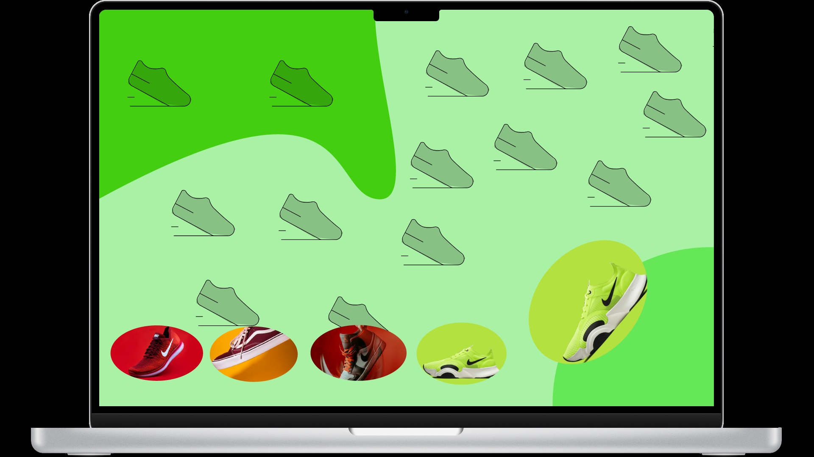
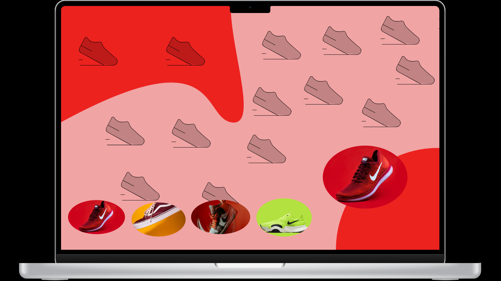
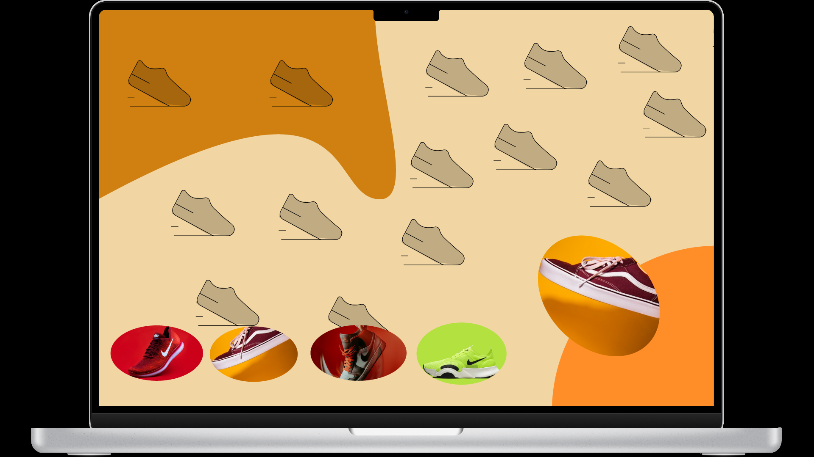
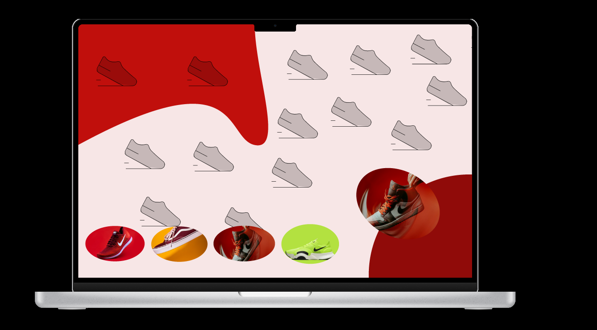
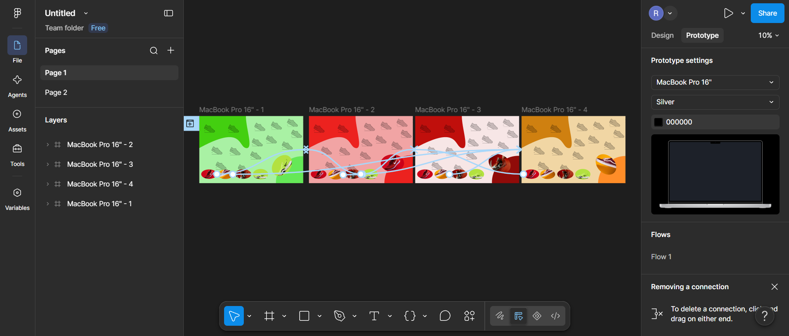
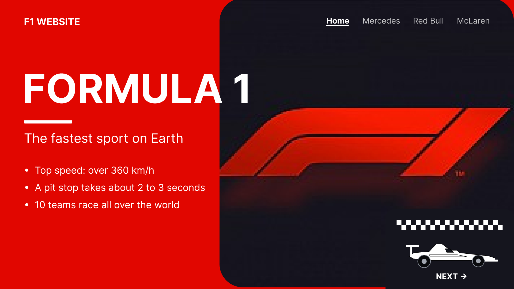
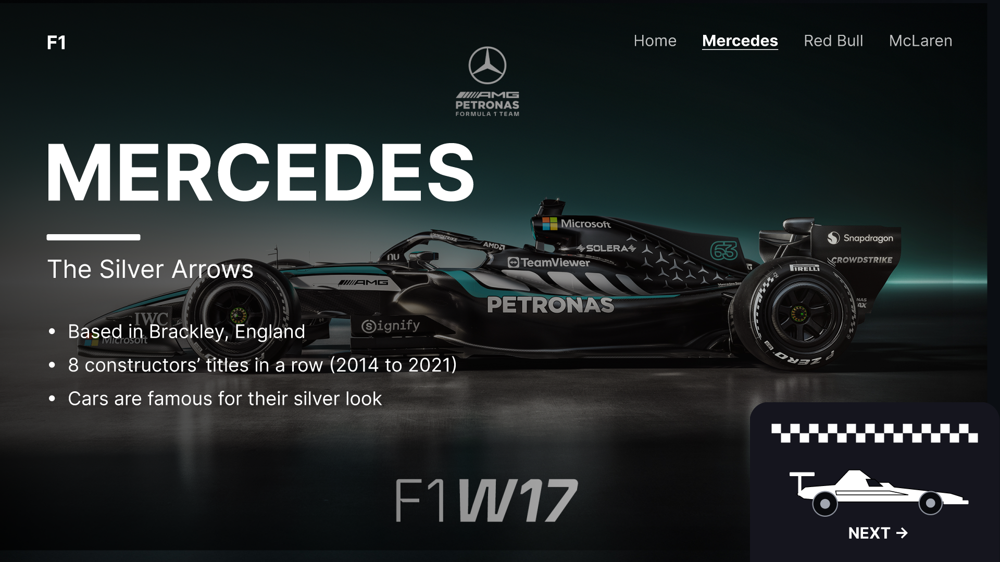
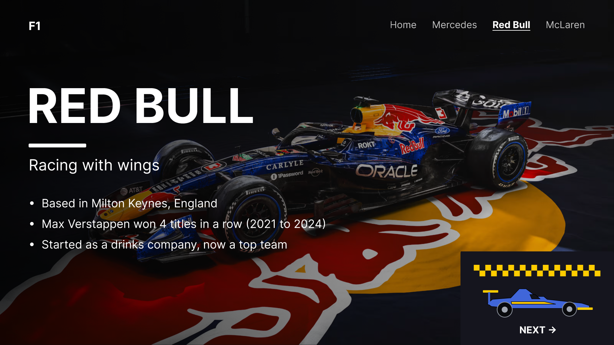
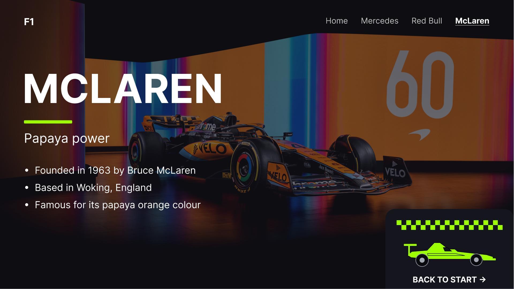
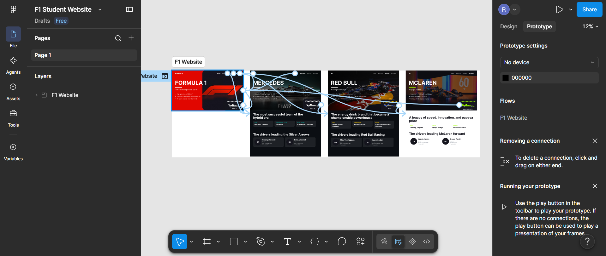

# Lab 8 — UI/UX Prototyping with Figma

**Rizwan Shariff S M** · **4NI25CS163**  
1BCS303 — Collaborative Development and DevOps  
Department of Computer Science and Engineering, NIE Mysuru

---

## Overview

The last CDD experiment moves from code to design. Two Figma files were built to
practise frames, reusable elements, layer grouping and clickable prototype flows.

## Prototype 1 — Lab website (shoe brand)

A four-screen desktop concept for a shoe brand. Every screen keeps the same
composition: a curved colour block in the top-left corner, a field of small
line-art shoe illustrations, four oval photo masks along the bottom and one large
featured shoe photograph in an oval on the right.

Only the palette changes between screens, so the set reads as one product rather
than four unrelated designs.

| Frame | Colour direction |
|---|---|
| `MacBook Pro 16" - 1` | Green / lime |
| `MacBook Pro 16" - 2` | Rose / crimson |
| `MacBook Pro 16" - 3` | Amber / sand |
| `MacBook Pro 16" - 4` | White / deep red |

The file lives in the **Team folder** (Free plan) with two pages. Page 1 holds the
four frames side by side; Page 2 is left for scratch work. The four frames are
wired together in the Prototype tab as **Flow 1**.

### Screens

### Prototype

## Prototype 2 — F1 Student Website

A four-screen motorsport portal built in **Drafts**. The screens share a fixed
header (`Home · Mercedes · Red Bull · McLaren`), a headline with a coloured rule,
three facts and a `NEXT →` control, so the visitor always knows where they are.

| Screen | Headline | Facts shown |
|---|---|---|
| Home | Formula 1 | top speed, pit-stop time, number of teams |
| Mercedes | The Silver Arrows | base in Brackley, 8 titles in a row, silver livery |
| Red Bull | Racing with wings | base in Milton Keynes, 4 titles in a row, drinks company origin |
| McLaren | Papaya power | founded 1963, base in Woking, papaya orange |

The prototype is published as the flow **F1 Website**, moving Home → Mercedes →
Red Bull → McLaren and back to the start.

### Screens

### Prototype

## What I practised

- building frames and arranging them on a shared page
- reusing one visual element (the shoe illustration, the header bar) instead of
  redrawing it on every screen
- keeping layers and groups readable in the Layers panel
- choosing a palette per screen while keeping the layout identical
- connecting screens in the Prototype tab and checking the flow end to end
- treating a design file as a shared reference for a team
